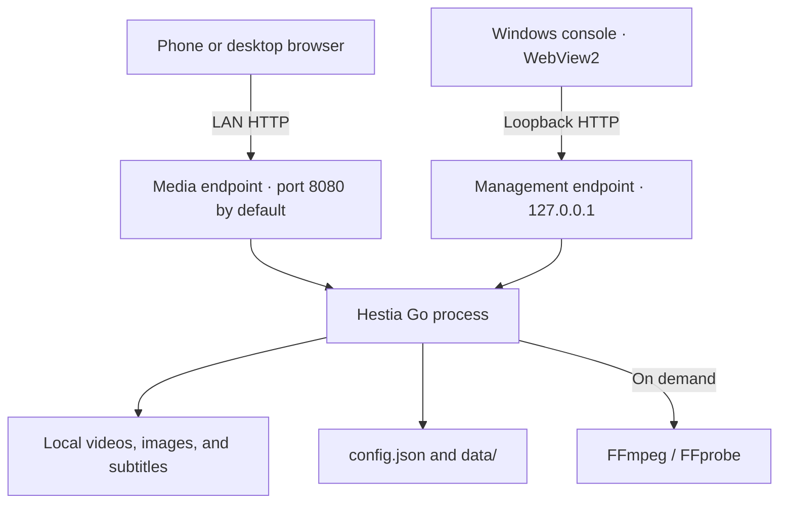

# Hestia · Home media server

[简体中文](README.md) | English | [日本語](README.ja.md)

Hestia is a self-hosted home media server for Windows, macOS, and Linux. It brings videos and photos from local drives and folders into one library. Search, browse, and watch from a phone or computer on the same local network. It supports SRT and ASS subtitles, resume playback, and on-demand FFmpeg transcoding.

## Quick start

### Windows

1. Download `Hestia.exe` (Windows x64) from the [latest release](https://github.com/maishede/hestia/releases/latest) and put it in a folder you can write to.
2. Double-click the executable. The server starts with the console. If the app reports a missing runtime, install the [Microsoft Edge WebView2 Runtime](https://developer.microsoft.com/en-us/microsoft-edge/webview2/).
3. Choose **Add folder** (「添加文件夹」 in the default interface) and select a folder with videos or photos. You can add several libraries. They are ready to browse when scanning finishes.
4. Select **Open web app** (「打开网页」 by default) in the footer to use Hestia on this computer. On a phone on the same LAN, open the address in the footer, such as `http://192.168.1.10:8080`. Use the address shown in the console. At startup, Hestia tries up to 20 higher port numbers if the configured port is unavailable.

When you close the console, you can keep the server running in the tray or stop it and exit. Click the tray icon or open the EXE again to restore the window.

### macOS and Linux

[Build from source](#build-from-source) and run the executable in a terminal. On its first run, Hestia creates `config.json` beside the executable. Add your media directory to that file using the example below, then open the address shown in the terminal. Press `Ctrl+C` to stop the server.

## Organize your library

Add the outer folder as a media library. Each folder one level below that root appears as a collection on the home page and can contain more folders.

```text
Library root
└── Weekend movies
    ├── poster.jpg
    ├── Alice-Far Away.mp4
    ├── Alice-Far Away.en.srt
    └── Extras
        └── Behind the scenes.mp4
```

- `poster.jpg` can serve as the collection cover. An image with the same base name as a video, such as `Alice-Far Away.jpg`, can be used on that video's card.
- Search matches video and image filenames. It supports Chinese substring matches, full pinyin and initials, English letters in order with gaps, and space-separated terms.
- Sort files in a folder by name, date modified, or size. Sort search results by relevance or date modified.
- Videos named `Cast-Title` appear in the cast filter. Use the sidebar on desktop or the dropdown on a phone. Search counts cast members across all matching results. Select × in the search box to return to all collections.
- Files directly under the library root appear in search. Root-level videos that follow the naming convention also appear in the cast filter.

## Playback and subtitles

Hestia plays browser-compatible files directly, such as typical H.264 MP4 files. When conversion is needed, Hestia uses FFmpeg to create an HLS stream for the browser. External subtitles can share the video's base name or use a language suffix such as `.en.srt`. Supported embedded text subtitles are available in the player's CC menu. Resume playback uses the newer position recorded by the browser or the server.

| Input | Controls |
|---|---|
| Desktop | Click the video to play or pause. The player can fill the web page or enter browser fullscreen. |
| Phone | Swipe up or down on the left for brightness and on the right for volume (seeking on iOS). Swipe horizontally to seek. Hold for 2× speed, double-tap either side to skip 10 seconds, or double-tap the center to play or pause. |
| Keyboard | Space or K to play or pause. J/L skip 10 seconds, left/right arrows skip 5 seconds, up/down arrows adjust volume, and F toggles fullscreen. |

The player offers 0.5×, 1×, 1.5×, and 2× speeds and can switch to the previous or next video in the same folder.

### Optional FFmpeg and FFprobe

[FFmpeg](https://ffmpeg.org/download.html) handles transcoding, video cover frames, and embedded text subtitle extraction. FFprobe identifies media codecs and subtitle tracks. Transcoding requires an FFmpeg build with the `libx264` encoder.

Hestia looks for both programs beside its executable, in `bin/`, in `ffmpeg/bin/`, then on the system `PATH`. Restart Hestia after installing them. **Settings** in the Windows console shows the FFmpeg status.

## Windows console tasks

- **Rescan** after adding or moving files. Hestia also scans at startup and when you add or enable a library. When a scan finds an unavailable library, its contents are hidden until you rescan after restoring the path.
- **Generate covers** and select **Start** after a scan. Hestia reuses valid cached covers. You can hide the dialog and keep using the console. Results open when the task finishes. Expand the details to see why individual covers could not be generated. Stopping keeps the covers generated so far. Covers also load on demand while browsing, including those from very large images.
- **Switch language** under **Settings → Language** (「设置 → 语言」 by default) for the console or through the top-bar selector for the website. Both support Simplified Chinese, English, and Japanese and save their choices separately. Simplified Chinese is the default.
- **Check for updates** under **Settings**. Installation downloads the new EXE, verifies its SHA-256 checksum, replaces it, and restarts Hestia. Your configuration and data are kept. The program folder must be writable.

## Settings, data, and access

Hestia keeps `config.json` and `data/` beside the executable by default. `data/` holds playback progress, thumbnail and subtitle caches, temporary transcoding files, and logs. On Windows, it also holds the WebView2 profile. Open `data/logs/hestia.log` directly or through the Windows console.

You can edit the configuration file while Hestia is running. Edits are normally read within about two seconds. After changing ports, use the new address. The example uses a Windows path. Set the path to your media directory on macOS or Linux. `autoStart` controls Windows startup at sign-in. `openBrowser` controls browser launch on macOS and Linux.

```json
{
  "port": 8080,
  "listen": "0.0.0.0",
  "openBrowser": true,
  "autoStart": false,
  "language": "zh-CN",
  "libraries": [
    { "path": "D:\\Movies", "label": "Movies", "enabled": true }
  ]
}
```

**Network access.** Hestia listens on `0.0.0.0` by default. Devices on the local network can browse and play media without signing in. Use a trusted LAN and keep the port off the public internet. To restrict access to this computer, set `listen` to `127.0.0.1`.

**Removing a library and deleting files.** Removing a library in the console removes it from Hestia and keeps its files on disk. The delete action on a media detail page previews the affected files first. Confirming permanently deletes videos, images, and subtitles directly inside that folder, then renames it to `original-name-reason`. Subfolders and other files are kept. Devices on the LAN need the deletion code shown on the Hestia computer. Restarting Hestia changes the code.

## Architecture



1. `internal/index` scans the media directories and builds an in-memory index. Pagination, filename search, cast filters, and cover matching use that index.
2. `internal/server` serves the media API. Direct playback reads byte ranges from the original file. Transcoding runs FFmpeg to produce temporary HLS segments, with up to three sessions at once. The player asks the server to end its session when you leave playback. The server also reclaims idle sessions.
3. `web/` contains browsing and playback, and `web/gui/` contains the Windows console. The Go build embeds both using `go:embed`. The website uses HTML, CSS, JavaScript modules, and the bundled xgplayer and hls.js libraries.

## Build from source

Use Go 1.27 or later. The Go dependencies are included in `vendor/`, and the Go build embeds the web assets.

| Platform | Run from the repository root | Output |
|---|---|---|
| Windows | `.\build.bat` in PowerShell | `dist/Hestia.exe` |
| macOS | `bash build.sh` | `dist/Hestia.app/Contents/MacOS/Hestia` |
| Linux | `bash build.sh` | `dist/Hestia` |

For development, set `HESTIA_HOME` to keep test data and configuration in a separate directory. On Windows, set it in PowerShell before running the app.

```powershell
$env:HESTIA_HOME = Join-Path (Get-Location) '.dev'
go run -mod=vendor .
```

On macOS or Linux, set the directory in the launch command.

```bash
HESTIA_HOME="$PWD/.dev" go run -mod=vendor .
```

Use `GOOS` and `GOARCH` to select the target platform when cross-compiling.

```bash
mkdir -p dist
GOOS=windows GOARCH=amd64 go build -mod=vendor -trimpath -ldflags "-s -w -H windowsgui" -o dist/Hestia.exe .
GOOS=darwin GOARCH=arm64 go build -mod=vendor -trimpath -ldflags "-s -w" -o dist/Hestia-darwin-arm64 .
GOOS=linux GOARCH=amd64 go build -mod=vendor -trimpath -ldflags "-s -w" -o dist/Hestia-linux-amd64 .
```

Run `go test -mod=vendor ./...` for the Go tests. See also the [end-to-end playback tests](tools/player-tests/README.md).

## Compatibility and third-party components

- ASS styling is lost when subtitles are converted to WebVTT. Embedded PGS image subtitles are unsupported.
- Thumbnail generation supports JPEG (including JFIF) and PNG. Other image formats are served as originals. Whether HEIC and similar formats display depends on the browser.
- Chinese names sort by Unicode code point. Search supports pinyin.

| Component | License | Purpose |
|---|---|---|
| [go-pinyin](https://github.com/mozillazg/go-pinyin) | MIT | Pinyin search |
| [go-webview2](https://github.com/jchv/go-webview2) | MIT | Windows console |
| [hls.js](https://github.com/video-dev/hls.js) | Apache-2.0 | Browser HLS playback |
| [xgplayer](https://github.com/bytedance/xgplayer) | [MIT](web/assets/js/vendor/xgplayer.LICENSE.txt) | Web player |

FFmpeg and FFprobe are external programs you install separately. Their licenses depend on the build options. See the [FFmpeg license notes](https://ffmpeg.org/legal.html).
