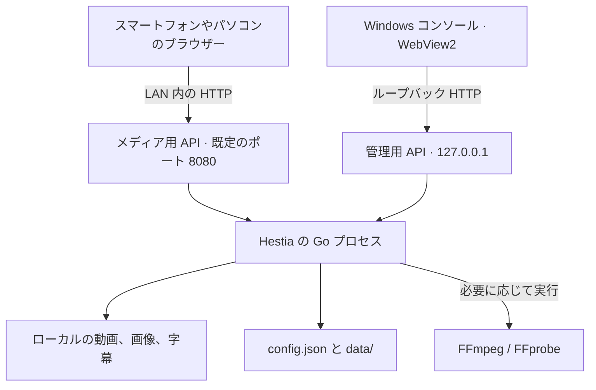

# Hestia · ホームメディアサーバー

[简体中文](README.md) | [English](README.en.md) | 日本語

Hestia は、Windows、macOS、Linux で使える自宅向けのセルフホスト型メディアサーバーです。複数のドライブやフォルダーに保存した動画と写真をまとめ、家庭内 LAN でスマートフォンやパソコンのブラウザーから検索・閲覧・再生できます。SRT・ASS 字幕、続きからの再生、FFmpeg によるオンデマンド変換に対応します。

## クイックスタート

### Windows

1. [最新リリース](https://github.com/maishede/hestia/releases/latest)から Windows x64 用の `Hestia.exe` をダウンロードし、書き込み可能なフォルダーに置きます。
2. 実行ファイルをダブルクリックします。コンソールと一緒にサーバーが起動します。ランタイムが見つからないと表示された場合は、[Microsoft Edge WebView2 Runtime](https://developer.microsoft.com/en-us/microsoft-edge/webview2/) をインストールしてください。
3. 「フォルダーを追加」（既定の表示では「添加文件夹」）から動画や写真のフォルダーを選びます。複数のライブラリを登録でき、スキャンが完了すると閲覧できます。
4. このパソコンで使う場合は、画面下部の「Web 画面を開く」（既定の表示では「打开网页」）を選びます。スマートフォンでは同じ LAN に接続し、画面下部に表示されるアドレス（例 `http://192.168.1.10:8080`）をブラウザーで開きます。起動時に指定ポートが使われていれば、続くポートを最大 20 個試すため、コンソールに表示されたアドレスを使用してください。

コンソールを閉じるときは、通知領域に格納してサーバーの動作を続けるか、停止して終了するかを選べます。通知領域のアイコンをクリックするか、EXE をもう一度開くとウィンドウが戻ります。

### macOS と Linux

[ソースからビルド](#ソースからビルド)し、ターミナルで実行ファイルを起動します。初回起動時に実行ファイルの隣に `config.json` が作成されます。下の例を参考にメディアフォルダーを設定し、ターミナルに表示されたアドレスをブラウザーで開きます。`Ctrl+C` でサーバーを停止できます。

## メディアライブラリの整理

一番外側のフォルダーをライブラリに追加します。直下の各フォルダーはホーム画面でコレクションとして表示され、さらに下の階層も閲覧できます。

```text
ライブラリのルート
└── 週末の映画
    ├── poster.jpg
    ├── アリス-遠い街.mp4
    ├── アリス-遠い街.ja.srt
    └── 特典映像
        └── 舞台裏.mp4
```

- `poster.jpg` はコレクションのカバーに使えます。`アリス-遠い街.jpg` のように動画と同名の画像は、その動画のカバーに使えます。
- 動画と画像のファイル名を検索できます。中国語の部分一致、ピンインの全表記と頭文字、英字を順番どおりに拾う飛び飛びの一致、空白で区切った検索語に対応します。
- フォルダー内のファイルは名前、更新日時、サイズで並べ替えられます。検索結果は関連度または更新日時で並べ替えられます。
- `出演者名-作品名` 形式の動画は出演者で絞り込めます。パソコンではサイドバー、スマートフォンではドロップダウンを使います。出演者の件数は検索結果全体で集計します。検索欄の × で全コレクションに戻れます。
- ライブラリのルート直下に置いたファイルも検索できます。命名規則に合う直下の動画は出演者の絞り込みにも表示されます。

## 再生と字幕

ブラウザーが対応する一般的な H.264 の MP4 などは直接再生できます。形式の変換が必要なときは FFmpeg で HLS ストリームを生成します。外部字幕は動画と同じベース名にするか、`.ja.srt` のように言語を指定します。対応する埋め込みテキスト字幕はプレーヤーの CC メニューで選べます。続きから再生する際は、ブラウザーとサーバーのうち新しい再生位置を使います。

| 操作方法 | 操作 |
|---|---|
| パソコン | 画面をクリックして再生・一時停止を切り替えます。プレーヤーをページ内いっぱいに広げたり、ブラウザーを全画面表示にしたりできます。 |
| スマートフォン | 左側を上下にスワイプして明るさ、右側で音量を調整します（iOS では右側で再生位置を移動します）。左右のスワイプで再生位置を移動できます。長押しで 2 倍速、左右のダブルタップで 10 秒移動、中央のダブルタップで再生・一時停止します。 |
| キーボード | Space または K で再生・一時停止。J/L で 10 秒、左右の矢印キーで 5 秒移動し、上下の矢印キーで音量、F で全画面表示を切り替えます。 |

再生速度は 0.5 倍、1 倍、1.5 倍、2 倍から選べます。同じフォルダー内の前後の動画にも切り替えられます。

### オプションの FFmpeg と FFprobe

[FFmpeg](https://ffmpeg.org/download.html) は動画の変換、カバー用のフレーム抽出、埋め込みテキスト字幕の抽出に使います。FFprobe はコーデックと字幕トラックを調べるために使います。動画の変換には `libx264` エンコーダーを含む FFmpeg が必要です。

Hestia は両方のプログラムを実行ファイルの隣、`bin/`、`ffmpeg/bin/`、システムの `PATH` の順で探します。導入後は Hestia を再起動してください。Windows コンソールの「設定」で FFmpeg の検出状況を確認できます。

## Windows コンソールでのよく使う操作

- **再スキャン**。ファイルを追加または移動したときに実行します。起動時と、ライブラリを追加・有効化したときにもスキャンします。スキャン時にアクセスできなかったライブラリは、パスが復旧して再スキャンするまで非表示になります。
- **カバー画像の生成**。スキャンが終わったら「カバー画像を生成」を選び、「開始」を押します。有効なキャッシュがあれば再利用します。ダイアログを閉じても処理は続き、完了すると結果が表示されます。詳細を開くと未生成の理由が分かります。「停止」を選んでも生成済みの画像は残ります。閲覧時も必要なカバー画像を読み込みます。特に大きい画像は閲覧時に処理します。
- **表示言語の変更**。コンソールの「設定 → 言語」（既定の表示では「设置 → 语言」）と、Web 画面上部のセレクターから変更できます。既定は簡体字中国語で、英語と日本語も選べます。選択はそれぞれ保存されます。
- **更新の確認**。「設定」から確認できます。更新時は新しい EXE をダウンロードし、SHA-256 を検証してから置き換えと再起動を行います。設定とデータは保存されます。プログラムのフォルダーに書き込めることが必要です。

## 設定・データ・アクセス

`config.json` と `data/` は既定で実行ファイルの隣に保存されます。`data/` には再生位置、サムネイルや字幕のキャッシュ、変換時の一時ファイル、ログが入ります。Windows 版では WebView2 のプロファイルもこのディレクトリに保存します。`data/logs/hestia.log` は直接開けます。Windows コンソールからも開けます。

動作中でも設定ファイルを編集でき、通常は約 2 秒で読み込みます。ポートを変更した後は新しいアドレスを使ってください。以下のパスは Windows の例です。macOS や Linux では実際のメディアフォルダーを指定してください。`autoStart` は Windows のサインイン時の自動起動、`openBrowser` は macOS と Linux のブラウザー自動起動を設定します。

```json
{
  "port": 8080,
  "listen": "0.0.0.0",
  "openBrowser": true,
  "autoStart": false,
  "language": "zh-CN",
  "libraries": [
    { "path": "D:\\Movies", "label": "映画", "enabled": true }
  ]
}
```

**ネットワークからのアクセス。** 既定では `0.0.0.0` で待ち受けるため、LAN 上の端末からログインせずに閲覧・再生できます。信頼できる LAN で使い、ポートをインターネットに公開しないでください。このパソコンだけで使う場合は `listen` を `127.0.0.1` に設定します。

**ライブラリ登録の解除とファイルの削除。** コンソールでライブラリ登録を解除しても、ファイルはディスクに残ります。メディア詳細ページの削除操作では、確認画面で削除対象を確認できます。実行すると対象フォルダー直下の動画、画像、字幕を完全に削除し、フォルダー名を `元の名前-理由` に変更します。サブフォルダーとその他のファイルは保持されます。LAN 上の別の端末から削除するには、Hestia を実行しているパソコンに表示される認証コードが必要です。再起動するとコードは変わります。

## 技術構成



1. `internal/index` はメディアフォルダーをスキャンし、メモリ上にインデックスを作ります。ページ分割、ファイル名検索、出演者の絞り込み、カバー画像の選択に使います。
2. `internal/server` はメディア用 API を提供します。直接再生では元ファイルから必要なバイト範囲を読み取り、変換時は FFmpeg で一時的な HLS セグメントを生成します。変換セッションは最大 3 本です。プレーヤーを閉じるとセッションの終了が要求されます。サーバーは使われなくなったセッションも終了します。
3. `web/` は閲覧と再生の画面、`web/gui/` は Windows の管理画面です。Go のビルド時に `go:embed` で両方を実行ファイルに組み込みます。Web 画面は HTML、CSS、JavaScript モジュールと、同梱の xgplayer、hls.js で動作します。

## ソースからビルド

Go 1.27 以降が必要です。Go の依存パッケージは `vendor/` に収録されており、Web のファイルは Go のビルド時に組み込まれます。

| プラットフォーム | リポジトリのルートで実行 | 出力先 |
|---|---|---|
| Windows | PowerShell で `.\build.bat` | `dist/Hestia.exe` |
| macOS | `bash build.sh` | `dist/Hestia.app/Contents/MacOS/Hestia` |
| Linux | `bash build.sh` | `dist/Hestia` |

開発時は `HESTIA_HOME` を設定すると、テスト用の設定とデータを別のディレクトリに保存できます。Windows の PowerShell では次のように実行します。

```powershell
$env:HESTIA_HOME = Join-Path (Get-Location) '.dev'
go run -mod=vendor .
```

macOS と Linux では次のように実行します。

```bash
HESTIA_HOME="$PWD/.dev" go run -mod=vendor .
```

クロスコンパイルでは `GOOS` と `GOARCH` で対象の OS とアーキテクチャを指定します。

```bash
mkdir -p dist
GOOS=windows GOARCH=amd64 go build -mod=vendor -trimpath -ldflags "-s -w -H windowsgui" -o dist/Hestia.exe .
GOOS=darwin GOARCH=arm64 go build -mod=vendor -trimpath -ldflags "-s -w" -o dist/Hestia-darwin-arm64 .
GOOS=linux GOARCH=amd64 go build -mod=vendor -trimpath -ldflags "-s -w" -o dist/Hestia-linux-amd64 .
```

Go のテストは `go test -mod=vendor ./...` で実行できます。[プレーヤーのエンドツーエンドテスト](tools/player-tests/README.md)も用意されています。

## 互換性とサードパーティーコンポーネント

- ASS 字幕を WebVTT に変換すると装飾は失われます。埋め込みの PGS 画像字幕には対応していません。
- サムネイルを生成できる画像は JPEG（JFIF を含む）と PNG です。それ以外の形式は元画像を配信します。HEIC などを表示できるかはブラウザーによります。
- 中国語の名前は Unicode コードポイント順です。検索ではピンインを使えます。

| コンポーネント | ライセンス | 用途 |
|---|---|---|
| [go-pinyin](https://github.com/mozillazg/go-pinyin) | MIT | ピンイン検索 |
| [go-webview2](https://github.com/jchv/go-webview2) | MIT | Windows コンソール |
| [hls.js](https://github.com/video-dev/hls.js) | Apache-2.0 | ブラウザーでの HLS 再生 |
| [xgplayer](https://github.com/bytedance/xgplayer) | [MIT](web/assets/js/vendor/xgplayer.LICENSE.txt) | Web プレーヤー |

FFmpeg と FFprobe は別途インストールする外部プログラムです。ライセンスはビルドオプションによって異なります。[FFmpeg のライセンス説明](https://ffmpeg.org/legal.html)を参照してください。
