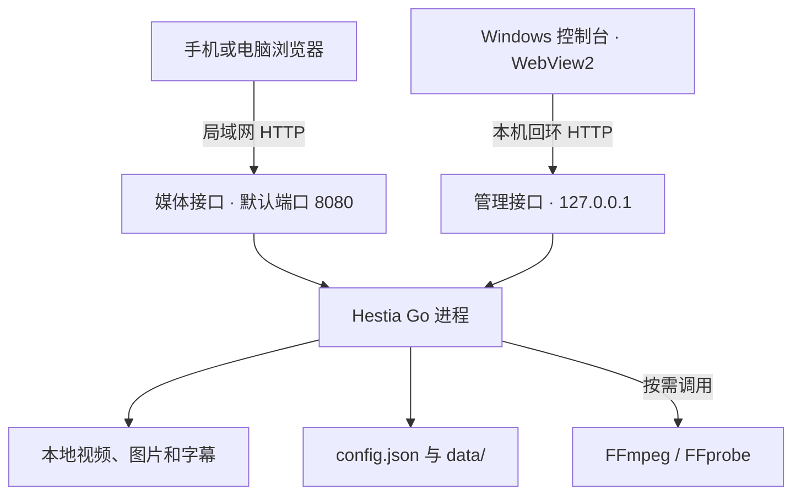

# Hestia · 家庭影视服务器

简体中文 | [English](README.en.md) | [日本語](README.ja.md)

Hestia 是一款支持 Windows、macOS 和 Linux 的自托管家庭媒体服务器。它把不同磁盘和文件夹中的本地视频、图片整理成媒体库，让手机和电脑在同一局域网内用浏览器搜索、浏览和播放。支持 SRT、ASS 字幕、断点续播和 FFmpeg 按需转码。

## 快速开始

### Windows

1. 从 [最新正式版](https://github.com/maishede/hestia/releases/latest) 下载 `Hestia.exe`（Windows x64），放到可写的文件夹中。
2. 双击运行。服务随控制台启动。如果提示缺少运行时，安装 [Microsoft Edge WebView2 Runtime](https://developer.microsoft.com/en-us/microsoft-edge/webview2/)。
3. 点击「添加文件夹」，选择存放视频或图片的目录。可以添加多个媒体库，扫描完成后就能浏览。
4. 在本机点击底栏的「打开网页」。手机连到同一局域网后，用浏览器打开底栏显示的访问地址，例如 `http://192.168.1.10:8080`。请以控制台显示的地址为准，启动时端口被占用会尝试顺延最多 20 个端口。

关闭控制台时，可以缩到托盘继续运行，也可以退出并停止服务。左键点击托盘图标或再次打开 EXE 可恢复窗口。

### macOS 和 Linux

按[从源码构建](#从源码构建)的说明生成可执行文件，在终端运行它。首次运行会在可执行文件旁创建 `config.json`。按下方示例填写媒体库路径，再用浏览器打开终端显示的地址。用 `Ctrl+C` 退出服务。

## 整理媒体库

把最外层目录添加为媒体库。每个一级子文件夹会在首页显示为一张合集卡片，下面还可以继续分层。

```text
媒体库根目录
└── 周末电影
    ├── poster.jpg
    ├── 林青-远方.mp4
    ├── 林青-远方.zh.srt
    └── 花絮
        └── 幕后.mp4
```

- `poster.jpg` 可以作为合集封面。同名图片，例如 `林青-远方.jpg`，可以作为对应视频的封面。
- 搜索按视频和图片的文件名匹配，支持中文子串、拼音全拼与首字母、英文按顺序跳字匹配以及空格分词。
- 文件夹内可按名称、修改日期或大小排序。搜索结果可按相关度或修改日期排序。
- `主演名-片名` 格式的视频会进入主演筛选。电脑端使用左侧栏，手机端使用下拉框。搜索时按全部命中结果统计主演，点击搜索框的 × 返回全部合集。
- 直接放在媒体库根目录的文件仍可搜索。符合命名规则的根目录视频也会进入主演筛选。

## 播放与字幕

浏览器支持的格式会直接播放，例如常见的 H.264 MP4。需要转换时，Hestia 调用 FFmpeg 生成供浏览器播放的 HLS 流。外部字幕可以与视频同名，或者在文件名中加语言后缀，如上例中的 `.zh.srt`。可提取的内嵌文本字幕在播放器的 CC 菜单中选择。续播使用浏览器和服务端记录里较新的进度。

| 操作 | 用法 |
|---|---|
| 桌面 | 单击画面播放或暂停。播放器可铺满网页或进入浏览器全屏。 |
| 手机 | 左侧上下滑调亮度，右侧上下滑调音量（iOS 上为跳转进度）。横滑可跳转，长按为 2 倍速，双击两侧可前后跳 10 秒，双击中间切换播放。 |
| 键盘 | 空格或 K 播放或暂停，J/L 前后跳 10 秒，左右方向键前后跳 5 秒，上下方向键调音量，F 切换全屏。 |

播放器支持 0.5×、1×、1.5× 和 2× 播放速度，也可以切换到同一文件夹里的上一部或下一部视频。

### 可选的 FFmpeg 和 FFprobe

[FFmpeg](https://ffmpeg.org/download.html) 用于转码、抽取视频封面和内嵌文本字幕。FFprobe 用于识别媒体编码和字幕轨。转码需要含 `libx264` 编码器的 FFmpeg 构建。

将这两个程序放到 Hestia 可执行文件旁、`bin/`、`ffmpeg/bin/`，或加入系统 `PATH`。Hestia 按这个顺序查找。安装后重新启动 Hestia，Windows 控制台的「设置」会显示 FFmpeg 状态。

## Windows 控制台常用操作

- 新增或移动媒体后点**「重新扫描」**。启动、添加或启用媒体库时也会扫描。扫描时发现无法访问的库会从网页隐藏，恢复路径后可重新扫描。
- 扫描后点**「生成封面」**和「开始」。有效缓存会直接复用。收起弹窗可继续操作，完成时会显示结果。未生成的项目可展开查看原因。点击「停止」会保留已生成的封面。浏览时也会按需加载封面，超大图片留到浏览时处理。
- 在**「设置 → 语言」**切换控制台语言，网页通过顶栏切换。默认简体中文，另有 English 和日本語。两边各自保存选择。
- 点击**「设置 → 检查更新」**。安装时会下载并验证 SHA-256，然后替换 EXE 并重启。配置和数据会保留，程序目录需可写。

## 配置、数据与安全

`config.json` 和 `data/` 默认保存在可执行文件旁。`data/` 保存播放进度、缩略图与字幕缓存、转码临时文件和日志。Windows 版还在这里保存 WebView2 数据。日志入口是 `data/logs/hestia.log`，Windows 控制台可直接打开。

配置文件可手动编辑，通常约两秒后读取。切换端口后请使用新地址访问。下面的路径是 Windows 示例，macOS 或 Linux 请换成实际媒体目录。`autoStart` 控制 Windows 登录时自启。`openBrowser` 控制 macOS 或 Linux 启动后是否打开浏览器。

```json
{
  "port": 8080,
  "listen": "0.0.0.0",
  "openBrowser": true,
  "autoStart": false,
  "language": "zh-CN",
  "libraries": [
    { "path": "D:\\电影", "label": "电影", "enabled": true }
  ]
}
```

**网络访问。** 默认监听 `0.0.0.0`，局域网内的访问者可直接浏览和播放。仅在可信局域网使用，避免将端口公开到互联网。只需要在本机使用时，将 `listen` 设为 `127.0.0.1`。

**移除与删除。** 控制台的「移除媒体库」只取消目录挂载，磁盘文件会保留。网页详情页的「删除所在文件夹媒体」会先预览范围，再永久删除该文件夹直属的视频、图片和字幕，并将文件夹改名为「原名-原因」。子文件夹和其他文件会保留。手机等局域网设备需要输入 Hestia 所在电脑显示的删除授权码。程序重启后授权码会更新。

## 技术架构



1. `internal/index` 扫描媒体目录，建立内存索引。分页、文件名搜索、主演筛选和封面匹配都使用同一份索引。
2. `internal/server` 提供媒体接口。直接播放时按需读取原文件的字节范围。转码时启动 FFmpeg，生成临时 HLS 分段。最多同时运行三个转码会话。退出播放器时会请求结束会话，服务端也会回收空闲会话。
3. 浏览与播放界面在 `web/`，Windows 管理界面在 `web/gui/`。Go 构建时用 `go:embed` 把两套界面打入可执行文件。网页使用原生 HTML、CSS、JavaScript 模块和随项目提供的 xgplayer、hls.js。

## 从源码构建

需要 Go 1.27 或更高版本。Go 依赖已放入 `vendor/`，前端直接随 Go 编译嵌入。

| 平台 | 在仓库根目录执行 | 产物 |
|---|---|---|
| Windows | PowerShell 中运行 `.\build.bat` | `dist/Hestia.exe` |
| macOS | `bash build.sh` | `dist/Hestia.app/Contents/MacOS/Hestia` |
| Linux | `bash build.sh` | `dist/Hestia` |

开发时可用 `HESTIA_HOME` 把配置和数据放到独立目录。Windows 下在 PowerShell 中设置变量后启动程序。

```powershell
$env:HESTIA_HOME = Join-Path (Get-Location) '.dev'
go run -mod=vendor .
```

macOS 和 Linux 可在启动命令中指定目录。

```bash
HESTIA_HOME="$PWD/.dev" go run -mod=vendor .
```

交叉编译时通过 `GOOS` 和 `GOARCH` 指定目标平台。

```bash
mkdir -p dist
GOOS=windows GOARCH=amd64 go build -mod=vendor -trimpath -ldflags "-s -w -H windowsgui" -o dist/Hestia.exe .
GOOS=darwin GOARCH=arm64 go build -mod=vendor -trimpath -ldflags "-s -w" -o dist/Hestia-darwin-arm64 .
GOOS=linux GOARCH=amd64 go build -mod=vendor -trimpath -ldflags "-s -w" -o dist/Hestia-linux-amd64 .
```

运行 `go test -mod=vendor ./...` 检查 Go 测试。还可参见[播放器端到端测试](tools/player-tests/README.md)。

## 兼容性与第三方组件

- ASS 字幕转为 WebVTT 后会丢失特效样式。内嵌 PGS 图片字幕暂不支持。
- 图片缩略图支持 JPEG（含 JFIF）和 PNG。其他格式由浏览器读取原图，HEIC 等格式能否显示取决于浏览器。
- 中文名称按 Unicode 码点排序。可以用拼音搜索。

| 组件 | 许可证 | 用途 |
|---|---|---|
| [go-pinyin](https://github.com/mozillazg/go-pinyin) | MIT | 拼音搜索 |
| [go-webview2](https://github.com/jchv/go-webview2) | MIT | Windows 控制台 |
| [hls.js](https://github.com/video-dev/hls.js) | Apache-2.0 | 浏览器 HLS 播放 |
| [xgplayer](https://github.com/bytedance/xgplayer) | [MIT](web/assets/js/vendor/xgplayer.LICENSE.txt) | 网页播放器 |

FFmpeg 和 FFprobe 是另行安装的外部程序。其许可证取决于构建选项，详见 [FFmpeg 许可说明](https://ffmpeg.org/legal.html)。
